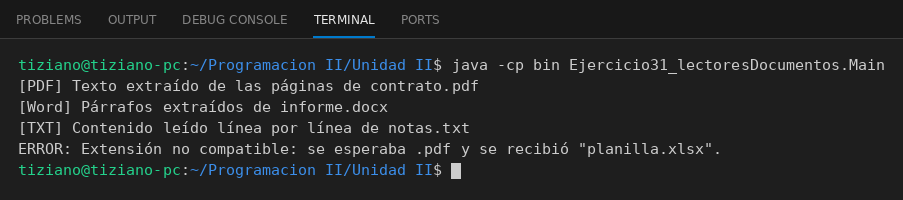

# LectorDocumento

Programación II - Unidad 2 - Ejercicio 31

## Consigna
Procesar distintos formatos de documento detrás de una abstracción común.

## Lógica
- Clase abstracta `LectorDocumento` con `abrirArchivo(ruta)` y `extraerTexto()` abstractos, más helpers de validación de extensión.
- `LectorPDF` (.pdf), `LectorWord` (.docx) y `LectorTextoPlano` (.txt); abrir un archivo con extensión no compatible lanza `IllegalArgumentException`.
- `Main`: lista de archivos procesada polimórficamente, con un archivo `.xlsx` que es rechazado.

## Ejecución

